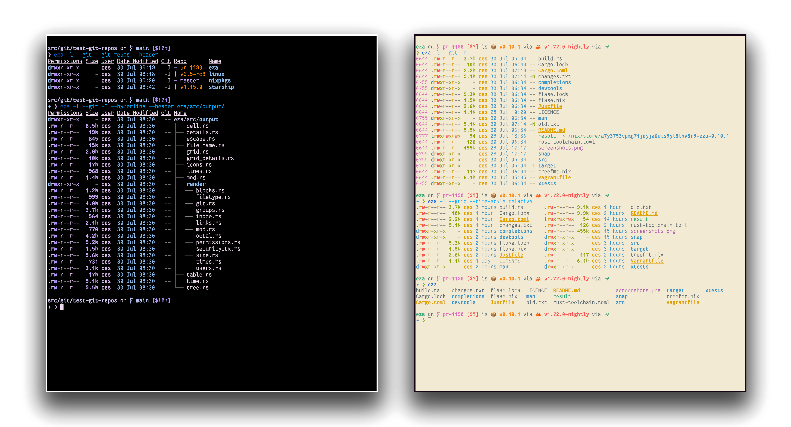

<!--
SPDX-FileCopyrightText: 2023-2024 Christina Sørensen
SPDX-FileContributor: Christina Sørensen

SPDX-License-Identifier: EUPL-1.2
-->

   特别致谢：
    
    
   

### [Warp，面向开发者的 AI 终端](https://www.warp.dev/eza)
[支持 macOS、Linux 与 Windows](https://www.warp.dev/eza) 

    
# eza

现代化的 `ls` 替代品。

> **语言**：[English](https://github.com/eza-community/eza/blob/main/README.md) | 简体中文（本文档）
>
> 本文档为 eza 官方 README 的简体中文译本。命令行选项、路径、命令、配置文件名等均保持原样未译，以保证可用性。
> 安装说明译文见 [INSTALL.zh-CN.md](INSTALL.zh-CN.md)，手册页译文见 [man/](./man/)。

---

**eza** 是 Unix 与 Linux 系统自带的文件列表命令行工具 `ls` 的现代化替代品，它提供了更多特性与更合理的默认行为。
它使用颜色来区分文件类型与元数据；
它支持符号链接、扩展属性与 Git；
而且它**体积小**、**速度快**，并且只是**一个单一的二进制文件**。

通过在若干设计取舍上刻意做出不同选择，eza 力图成为功能更丰富、对用户更友好的 `ls`。

---

**eza** 相比 exa 新增的特性（未完全列举）：

- 修复了 exa 2021 中引入的[“网格 Bug”（The Grid Bug）](https://github.com/eza-community/eza/issues/66#issuecomment-1656758327)。
- 支持超链接（hyperlink）。
- 支持挂载点详情。
- 支持 SELinux 安全上下文输出。
- 支持 Git 仓库状态输出。
- 支持人类可读的相对日期。
- 若干安全性修复。
- 支持 `bright`（高亮）终端颜色。
- 大量细小的缺陷修复与改动！
- 提供 `theme.yml` 配置文件，用于自定义颜色与图标。

……此外还有很多很多优点，以至于要持续更新这份清单实在让人吃不消。
说真的，好东西确实挺多的。

---

<a id="try-it">
<h1>立刻试用！</h1>
</a>

### Nix ❄️

如果你已经配置好支持 flake 的 Nix，可以通过 `nix run` 命令试用 eza：

    nix run github:eza-community/eza

Nix 会构建并运行 eza。

如果你需要以这种方式传递参数，可以像这样使用：`nix run github:eza-community/eza -- -ol`。

# 安装

eza 支持 Windows、macOS 与 Linux。各平台与各发行版的安装说明见 [INSTALL.md](INSTALL.md)（中译：[INSTALL.zh-CN.md](INSTALL.zh-CN.md)）。

---

<a id="options">
<h1>命令行选项</h1>
</a>

eza 的选项与 `ls` 的选项几乎、但又不完全一样。以下是快速概览：

## 显示选项

点击展开

- **-1**，**--oneline**：每行显示一个条目
- **-G**，**--grid**：以网格方式显示条目（默认）
- **-l**，**--long**：显示扩展详情与属性
- **-R**，**--recurse**：递归进入子目录
- **-T**，**--tree**：以树状结构递归进入子目录
- **-x**，**--across**：网格按横向排序，而非纵向
- **-F**，**--classify=(when)**：在文件名后显示类型标识符（always、auto、never）
- **--colo[u]r=(when)**：何时使用终端颜色（always、auto、never）
- **--colo[u]r-scale=(field)**：以差异化的方式高亮 `field` 字段的取值（all、age、size）
- **--color-scale-mode=(mode)**：`--color-scale` 使用渐变色还是固定色，可选值为 `fixed` 或 `gradient`
- **--icons=(when)**：何时显示图标（always、auto、never）
- **--hyperlink=(when)**：何时以超链接形式显示条目（always、auto、never）
- **--absolute=(mode)**：以绝对路径显示条目（on、follow、off）
- **-w**，**--width=(columns)**：以列为单位设置屏幕宽度

## 过滤选项

点击展开

- **-a**，**--all**：显示隐藏文件与“点文件”
- **-d**，**--treat-dirs-as-files**：像普通文件一样列出目录本身
- **-L**，**--level=(depth)**：限制递归深度
- **-r**，**--reverse**：反转排序顺序
- **-s**，**--sort=(field)**：按哪个字段排序
- **--group-directories-first**：将目录排在其他文件之前
- **--group-directories-last**：将目录排在其他文件之后
- **-D**，**--only-dirs**：只列出目录
- **-f**，**--only-files**：只列出文件
- **--no-symlinks**：不显示符号链接
- **--show-symlinks**：显式显示符号链接（与 `--only-dirs`、`--only-files` 配合使用，用于显示符合过滤条件的符号链接）
- **--git-ignore**：忽略 `.gitignore` 中提到的文件
- **-I**，**--ignore-glob=(globs)**：需要忽略的文件的 glob 模式（以竖线分隔）

将 `--all` 选项传递两次，还会显示 `.` 与 `..` 目录。

## 长视图选项

点击展开

以下选项需配合 `--long`（`-l`）使用：

- **-b**，**--binary**：以二进制前缀列出文件大小
- **-B**，**--bytes**：以字节为单位列出文件大小，不带任何前缀
- **-g**，**--group**：列出每个文件的所属组
- **--smart-group**：仅当组名与所有者名不同时才显示组
- **-h**，**--header**：为每列添加表头行
- **-H**，**--links**：列出每个文件的硬链接数
- **-i**，**--inode**：列出每个文件的 inode 编号
- **-m**，**--modified**：使用修改时间（modified）字段
- **-M**，**--mounts**：显示挂载详情（仅支持 Linux 与 macOS）
- **-S**，**--blocksize**：显示已分配的文件系统块大小
- **-t**，**--time=(field)**：使用哪个时间戳字段
- **-u**，**--accessed**：使用访问时间（accessed）字段
- **-U**，**--created**：使用创建时间（created）字段
- **-X**，**--dereference**：解引用符号链接以获取文件信息
- **-Z**，**--context**：列出每个文件的安全上下文
- **-@**，**--extended**：列出每个文件的扩展属性及其大小
- **--changed**：使用变更时间（changed）字段
- **--git**：列出每个文件的 Git 状态（无论被跟踪还是被忽略）
- **--git-repos**：列出每个目录的 Git 状态（若被跟踪）
- **--git-repos-no-status**：仅列出某个目录是否为 Git 仓库，而不显示其状态（速度更快）
- **--no-git**：不显示 Git 状态（始终覆盖 `--git`、`--git-repos`、`--git-repos-no-status`）
- **--time-style**：如何格式化时间戳。有效的时间戳样式为 ‘`default`’、‘`iso`’、‘`long-iso`’、‘`full-iso`’、‘`relative`’，或自定义样式 ‘`+<FORMAT>`’（例如 ‘`+%Y-%m-%d %H:%M`’ 对应 ‘`2023-09-30 13:00`’。有关格式字符串的更多说明，请参阅 _`eza(1)` 手册页_ 与 [chrono 文档](https://docs.rs/chrono/latest/chrono/format/strftime/index.html)。）
- **--total-size**：显示目录的递归总大小
- **--no-permissions**：隐藏权限字段
- **-o**，**--octal-permissions**：以八进制格式列出每个文件的权限
- **--no-filesize**：隐藏文件大小字段
- **--no-user**：隐藏所有者字段
- **--no-time**：隐藏时间字段
- **--stdin**：从标准输入读取文件名

其中部分选项接受参数：

- **--colo\[u\]r** 的有效取值为 **always**、**automatic**（简写为 **auto**）与 **never**。
- 有效的排序字段为 **accessed**、**changed**、**created**、**extension**、**Extension**、**inode**、**modified**、**name**、**Name**、**size**、**type** 与 **none**。以大写字母开头的字段会将大写字母排在小写字母之前。modified 字段具有别名 **date**、**time** 与 **newest**；其反向则有别名 **age** 与 **oldest**。
- 有效的时间字段为 **modified**、**changed**、**accessed** 与 **created**。
- 有效的时间样式为 **default**、**iso**、**long-iso**、**full-iso** 与 **relative**。

更详细的用法说明请查阅 `man` 手册页，获取方式：
- 在线版本[位于本仓库中](https://github.com/eza-community/eza/tree/main/man)（中译：[man/](./man/)）
- 从 [`[0.18.13] - 2024-04-25`](https://github.com/eza-community/eza/blob/main/CHANGELOG.md#01813---2024-04-25) 版本起，可在终端中通过 `man eza` 查阅

## 自定义主题

点击展开

**Eza** 近期新增了对 `theme.yml` 文件的支持。在该文件中，你可以指定 `LS_COLORS` 与 `EXA_COLORS` 环境变量所支持的全部主题选项，也可以为不同的文件类型与扩展名指定不同的图标。出于向后兼容的考虑，任何已设置的环境变量仍会生效，并且优先级更高。

#### **新增** 预制主题
欢迎前往官方 [eza-themes](https://github.com/eza-community/eza-themes) 仓库选用现成主题，也可以贡献你自己的主题。

`docs/theme.yml` 中提供了一个主题文件示例。该文件需要放置在由环境变量 `EZA_CONFIG_DIR` 指定的目录中，否则会默认在 `$XDG_CONFIG_HOME/eza` 下查找。

完整说明见[手册页](https://github.com/eza-community/eza/tree/main/man/eza_colors-explanation.5.md)（中译：[man/eza_colors-explanation.5.zh-CN.md](./man/eza_colors-explanation.5.zh-CN.md)），主题文件示例见[此处](https://github.com/eza-community/eza/tree/main/docs/theme.yml)

# 参与 eza 开发

如果你想为 eza 贡献代码，首先需要遵守我们的
[行为准则](https://github.com/eza-community/eza/blob/main/CODE_OF_CONDUCT.md)（中译：[CODE_OF_CONDUCT.zh-CN.md](CODE_OF_CONDUCT.zh-CN.md)）。
在了解行为准则之后，可以阅读
[CONTRIBUTING.md](https://github.com/eza-community/eza/blob/main/CONTRIBUTING.md)（中译：[CONTRIBUTING.zh-CN.md](CONTRIBUTING.zh-CN.md)）
了解实际开发相关的更多信息。

